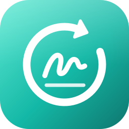
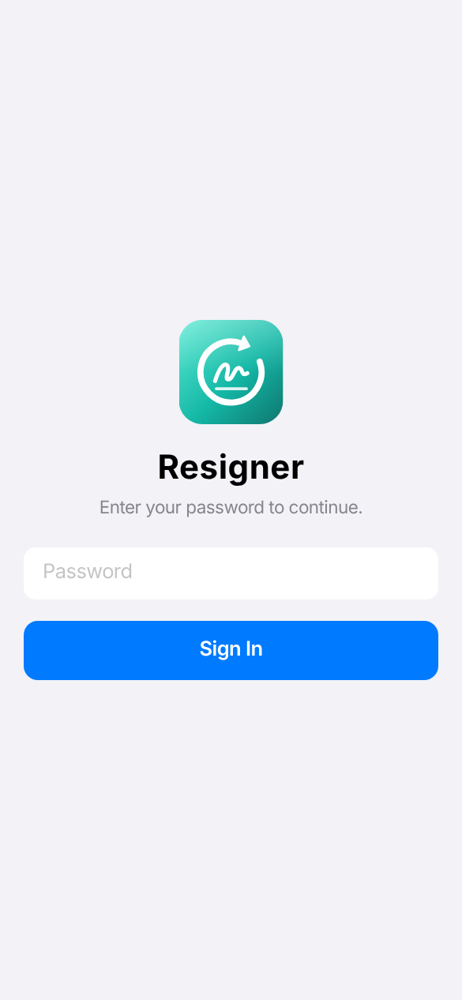
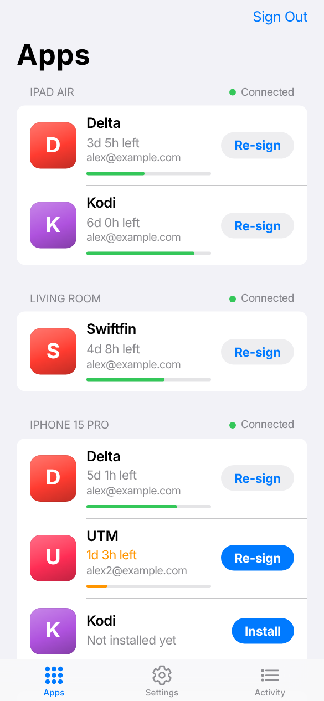
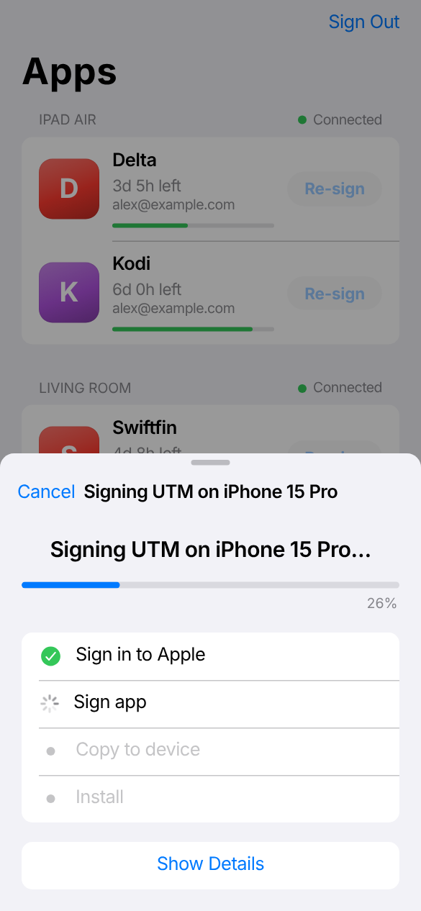
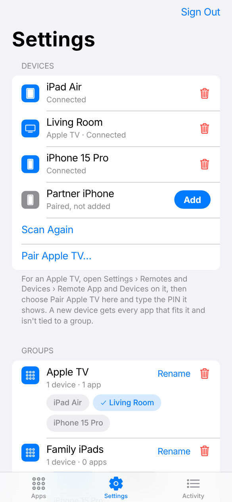

<div align="center">
  <a href="https://github.com/ErikSeiter/sideloop-nas">
    
  </a>
  <h3 align="center">Sideloop for NAS (fixed for Apple's Oct 2026 sign-in)</h3>
</div>

> Keep sideloaded IPAs signed with a free Apple ID, re-installed over Wi-Fi before the 7-day signature expires.

This is a fork of [filippofinke/sideloop](https://github.com/filippofinke/sideloop) (MIT) that **signs in again after Apple's October 2026 changes** and comes with a step-by-step guide for running it on a **NAS** (written and tested on a UGREEN DXP4800 running UGOS Pro).

| Guide | |
| --- | --- |
| [UGREEN NAS (UGOS Pro) setup guide](docs/UGOS-NAS-GUIDE.md) | From an empty Docker app to an installed app on your iPhone |
| [Troubleshooting](docs/TROUBLESHOOTING.md) | Every Apple / AltServer error we hit, with the fix |

### What is different from upstream

| Problem | Upstream | This fork |
| --- | --- | --- |
| Apple sign-in fails with `-22411`, `-80045`, `-80046` | Builds the September AltServer tag | Builds AltServer tag `ng-2026-11-05`, which provisions its own anisette identity per install |
| Anisette server | Local `dadoum/anisette-v3-server` container | A public v3 server by default (`ANISETTE_SERVER`); the local one is an optional compose profile |
| Install fails with `Failed to set app extension placeholders` | Only warns that extensions use extra App IDs | **Remove App Extensions** switch when you add an IPA (on by default); the original is kept as `app.orig.ipa` |
| "Sign-in helper isn't running" with a public server | Any non-200 answer counts as down | Any HTTP answer counts as up |
| NAS deployment | None | Single-file compose for UGOS Docker: [`nas/docker-compose.ugos.yml`](nas/docker-compose.ugos.yml) |

Everything else, including the two AltServer patches, is upstream's.

A small self-hosted service with a web UI for any Linux machine (amd64 or arm64) or a Mac. It re-signs your apps with [AltServer-Linux](https://github.com/jaakkopalvaila/AltServer-Linux) and installs them in place, so app data is kept. You don't need AltStore or SideStore on the device.

## Features

- [x] Multiple apps on multiple iPhones and iPads
- [x] Automatic re-signing when a device comes online, before the signature expires
- [x] Web UI for pairing, uploading IPAs, 2FA codes and live progress
- [x] Checks each IPA for FairPlay encryption, tweaks and app extensions
- [x] Apple sign-in through any anisette v3 server: public ones, or your own [anisette-v3-server](https://github.com/Dadoum/anisette-v3-server). `ANISETTE_SERVER` can list several; a failing server is set aside for 15 minutes and the next one is used
- [x] Optional removal of app extensions so free Apple IDs can install apps that have them
- [x] **Groups** of devices: tie an app to a group (for example "Family iPads") and it only goes to that group's devices; a new device only gets the apps that aren't tied to a group
- [x] **Several Apple IDs** in a priority order: a new app is signed with the first Apple ID that still has room and the next one takes over when Apple says the limit is reached. An installed app always stays with the Apple ID that signed it
- [x] Python standard library only, one Docker image for amd64 and arm64

## Demo (upstream)

https://github.com/user-attachments/assets/8c6b799d-b9e7-4a15-898d-d96a2af8e876

A two-minute narrated walkthrough: setup, adding devices and apps, the first install with a 2FA code, and automatic re-signing.

## Screenshots

| Login | Apps | Signing | Settings | Activity |
| :---: | :---: | :---: | :---: | :---: |
|  |  |  |  |  |

## Quick Start

Prerequisites

- Docker with Compose
- A throwaway Apple ID

Run on Linux

```bash
git clone https://github.com/ErikSeiter/sideloop-nas.git
cd sideloop-nas
cp .env.example .env
docker compose up -d
```

The first build compiles AltServer, which takes a few minutes. On a small board like a Raspberry Pi 3 it is much faster to build on another arm64 machine and copy the image over:

```bash
docker build --platform linux/arm64 -t sideloop .
docker save sideloop | gzip | ssh pi@<host> 'gunzip | docker load'
ssh pi@<host> 'cd sideloop && docker compose up -d --no-build'
```

Open `http://<host>:8080` and set a password. Then pair a device over USB, add an IPA and enter your Apple ID.

On a NAS with a Docker GUI (UGOS Pro, Synology, QNAP...) follow the [NAS guide](docs/UGOS-NAS-GUIDE.md) instead.

Run on macOS

Docker on macOS can't see USB or Wi-Fi devices, so bridge the system usbmuxd first:

```bash
socat TCP-LISTEN:27015,bind=127.0.0.1,reuseaddr,fork UNIX-CONNECT:/var/run/usbmuxd &
docker compose -f docker-compose.yml -f docker-compose.mac.yml up -d
```

Pair the device in Finder and enable **Show this iPhone when on Wi-Fi**.

## Notes

- Use the Apple ID's **regular password**. App-specific passwords don't work.
- Apple asks for a **2FA code** on the first sign-in. Enter it in the web UI (the background re-signer can't answer it). After that, sign-ins are normally silent.
- The device must be **unlocked and on the same Wi-Fi** while a re-sign runs.
- A free account allows 3 apps per device and 10 App IDs per week. Each app extension needs its own App ID.
- **Several Apple IDs:** add them under *Apple IDs* in Settings and order them with the arrows. The switch decides whether an Apple ID takes *new* apps; it never strands what it already signed. Sideloop counts the apps and App IDs it has signed per Apple ID as a hint, and treats Apple's "limit reached" answer as the real signal to try the next one. All Apple IDs share one anisette identity (it belongs to the install, not to an Apple ID). Each Apple ID is a separate developer for iOS, so trust each one once under **VPN & Device Management**. The first install with a new Apple ID needs a 2FA code, so a background run only picks an Apple ID that has signed something before; start that install from the web page.
- **Groups:** an app tied to one or more groups reaches exactly the devices in them. Deleting a group leaves its apps where they are; apps that followed no other group then go back to following new devices.
- Trust the developer once in **Settings > General > VPN & Device Management**. Refreshes keep it trusted.
- If Apple sign-in stops working, check for a newer tag at [jaakkopalvaila/AltServer-Linux](https://github.com/jaakkopalvaila/AltServer-Linux/tags) and update `ALTSERVER_TAG` in the `Dockerfile`. AltServer is built from that tag with the patches in `altserver/`. See [Troubleshooting](docs/TROUBLESHOOTING.md) for the error codes.
- The anisette identity (a file that works like a password for this "device") is stored in `./data/xdg`, one per server. Don't share it.

Data is stored in `./data`.

## Development

```bash
python3 -m unittest discover -s tests -t .
```

The tests run `scripts/refresh.sh` against stand-ins for AltServer and the libimobiledevice tools (`tests/stubs/`), so they need `bash`, `openssl`, `flock` and `script` but no phone and no Apple ID.

## Credits

Sideloop is by **Filippo Finke**; AltServer-Linux is by [jaakkopalvaila](https://github.com/jaakkopalvaila/AltServer-Linux) (a fork of [NyaMisty](https://github.com/NyaMisty/AltServer-Linux)). This fork only adds the changes listed above.

👤 **Filippo Finke** (upstream author)

- Website: [https://filippofinke.ch](https://filippofinke.ch)
- Twitter: [@filippofinke](https://twitter.com/filippofinke)
- GitHub: [@filippofinke](https://github.com/filippofinke)
- LinkedIn: [@filippofinke](https://linkedin.com/in/filippofinke)

## Support the upstream author

Give [the original project](https://github.com/filippofinke/sideloop) a ⭐️ if this helped you!

<a href="https://www.buymeacoffee.com/filippofinke">
  
</a>

## 📝 License

Copyright © 2026 [Filippo Finke](https://github.com/filippofinke).<br />
This project is [MIT](./LICENSE) licensed. Icons from [Ionicons](https://ionic.io/ionicons) (MIT).

***

_Not affiliated with Apple. Use a throwaway Apple ID._
