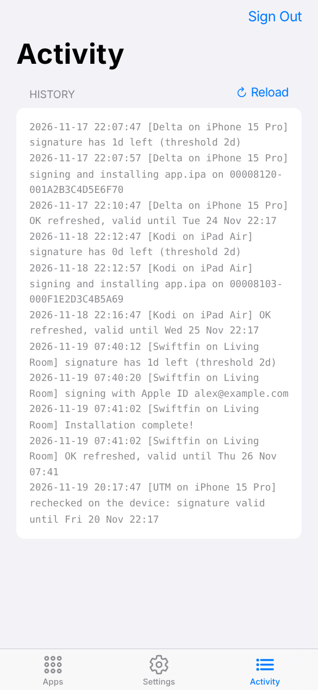
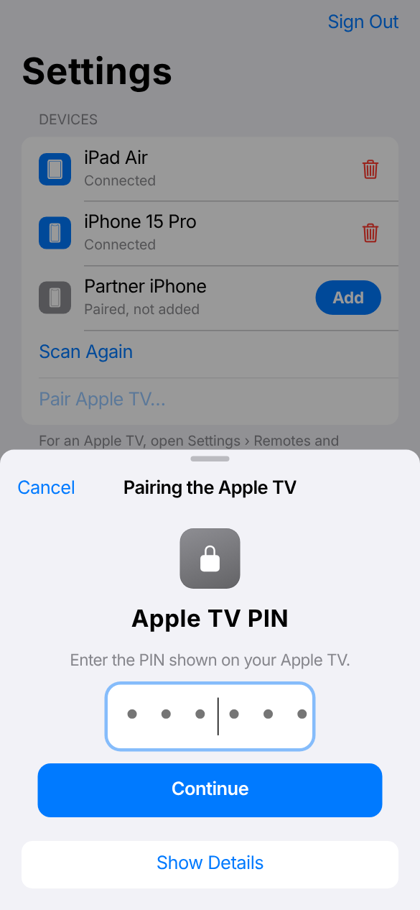
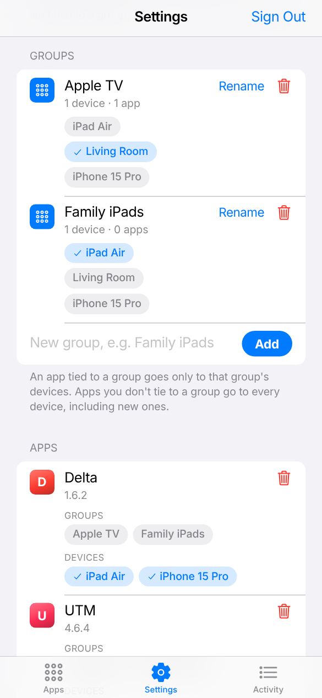

<div align="center">
  
  <h3 align="center">Resigner</h3>
  <p align="center">Keeps your sideloaded iPhone, iPad and Apple TV apps alive by re-signing them from your NAS.</p>
</div>

> A free Apple ID signs an app for only 7 days. Resigner signs your IPAs with that Apple ID and installs them again over Wi-Fi before the signature runs out, so the apps keep working and keep their data.

A small self-hosted service with a web UI for a **NAS** (written and tested on a UGREEN DXP4800 running UGOS Pro), any Linux machine (amd64 or arm64) or a Mac. It re-signs your apps with [AltServer-Linux](https://github.com/jaakkopalvaila/AltServer-Linux) and installs them in place. You don't need AltStore or SideStore on the device.

| Guide | |
| --- | --- |
| [UGREEN NAS (UGOS Pro) setup guide](docs/UGOS-NAS-GUIDE.md) | From an empty Docker app to an installed app on your iPhone |
| [Troubleshooting](docs/TROUBLESHOOTING.md) | Every Apple / AltServer error we hit, with the fix |

### Highlights

- **Apple sign-in that works after Apple's October 2026 changes.** The image builds AltServer tag `ng-2026-11-05`, which provisions its own anisette identity per install. A public anisette v3 server is used by default (`ANISETTE_SERVER`); a local one is an optional compose profile.
- **Apps with extensions install on a free Apple ID.** The *Remove App Extensions* switch (on by default when you add an IPA) strips them; the original is kept as `app.orig.ipa`.
- **Made for a NAS.** One compose file for the UGOS Docker app: [`nas/docker-compose.ugos.yml`](nas/docker-compose.ugos.yml).
- **Apple TV.** tvOS 17+ Apple TVs are paired with a PIN from the web page and get tvOS apps signed and installed over Wi-Fi (see [Apple TV](#apple-tv)).

## Features

- [x] Multiple apps on multiple iPhones and iPads
- [x] Automatic re-signing when a device comes online, before the signature expires
- [x] Web UI for pairing, adding IPAs (upload them or paste a link and the server downloads the file), 2FA codes and live progress
- [x] Checks each IPA for FairPlay encryption, tweaks and app extensions
- [x] Apple sign-in through any anisette v3 server: public ones, or your own [anisette-v3-server](https://github.com/Dadoum/anisette-v3-server). `ANISETTE_SERVER` can list several; a failing server is set aside for 15 minutes and the next one is used
- [x] Optional removal of app extensions so free Apple IDs can install apps that have them
- [x] **Groups** of devices: tie an app to a group (for example "Family iPads") and it only goes to that group's devices; a new device only gets the apps that aren't tied to a group
- [x] **Several Apple IDs** in a priority order: a new app is signed with the first Apple ID that still has room and the next one takes over when Apple says the limit is reached. An installed app always stays with the Apple ID that signed it
- [x] **Apple TV** (tvOS 17 and newer): pair it once with the PIN the TV shows, then tvOS apps are re-signed like the ones on your iPhone. iPhones and iPads keep using AltServer; the Apple TV path never touches them
- [x] Python standard library only, one Docker image for amd64 and arm64

## Screenshots

Made with demo data: made-up devices and Apple IDs.

| Login | Apps | Signing | Settings | Activity |
| :---: | :---: | :---: | :---: | :---: |
|  |  |  |  |  |

| Pair an Apple TV | Groups and apps |
| :---: | :---: |
|  |  |

## Quick Start

Prerequisites

- Docker with Compose
- A throwaway Apple ID

Run on Linux

```bash
git clone https://github.com/ErikSeiter/resigner.git
cd resigner
cp .env.example .env
docker compose up -d
```

The first build compiles AltServer, which takes a few minutes. On a small board like a Raspberry Pi 3 it is much faster to build on another arm64 machine and copy the image over:

```bash
docker build --platform linux/arm64 -t resigner .
docker save resigner | gzip | ssh pi@<host> 'gunzip | docker load'
ssh pi@<host> 'cd resigner && docker compose up -d --no-build'
```

Open `http://<host>:8080` and set a password. Then pair a device over USB, add an IPA and enter your Apple ID.

On a NAS with a Docker GUI (UGOS Pro, Synology, QNAP...) follow the [NAS guide](docs/UGOS-NAS-GUIDE.md) instead.

Run on macOS

Docker on macOS can't see USB or Wi-Fi devices, so bridge the system usbmuxd first:

```bash
socat TCP-LISTEN:27015,bind=127.0.0.1,reuseaddr,fork UNIX-CONNECT:/var/run/usbmuxd &
docker compose -f docker-compose.yml -f docker-compose.mac.yml up -d
```

Pair the device in Finder and enable **Show this iPhone when on Wi-Fi**.

## Apple TV

An Apple TV with tvOS 17 or newer is not reached like an iPhone: it has no USB or lockdown service for this, it is paired once with a PIN and then found on the network. Resigner uses [plumesign](https://github.com/bitxeno/PlumeImpactor) (MIT) for that part. The Docker image downloads a pinned release and checks its SHA-256; if that fails the image is still built, only without Apple TV support, and the web page says so.

1. Put the Apple TV and the machine running Resigner on the **same network** (same subnet, no guest Wi-Fi, no client isolation). Resigner has to run with `network_mode: host`, as in the compose files.
2. On the Apple TV open **Settings > Remotes and Devices > Remote App and Devices**. It waits there and shows a PIN when something asks to pair.
3. In Resigner open **Settings**, press **Pair Apple TV…**, choose the TV in the list and type the PIN it shows when the page asks for it.
4. Add a **tvOS** `.ipa` the usual way (upload it, or paste a link to it and the server downloads it). Resigner reads what the app's binary was built for (some tvOS builds claim iOS in their Info.plist), shows *Apple TV app* and only offers it to Apple TVs; iPhone apps are never offered to an Apple TV. A new Apple TV joins an empty group that only holds tvOS apps; otherwise it gets the tvOS apps that aren't tied to a group.
5. Press **Install** next to it. The first sign-in of an Apple ID for the Apple TV needs a 2FA code, entered on the web page (a free Apple ID is signed in separately for iOS and for tvOS, so an Apple ID that already works for your iPhone still asks once). After that the Apple TV is re-signed automatically when it is on and on the network.

Limits and things to know:

- Only **tvOS 17 and newer**, and only apps built for tvOS. The same free-account limits apply (3 apps per device, 10 App IDs per week).
- The Apple TV has to be **on and awake on the network** for a re-sign; if it isn't, Resigner waits and tries again later.
- A **tvOS update can drop the pairing**. Pair again from the web page if the TV stops being found.
- Switching off *Automatically Update tvOS* (Settings > System > Software Updates) avoids surprises.
- A different Apple ID is a different developer team, so an app stays with the Apple ID that signed it.
- The pairing and the signed-in Apple ID sessions are kept in `data/xdg/PlumeImpactor` (treat it like a password).

## Notes

- Use the Apple ID's **regular password**. App-specific passwords don't work.
- Apple asks for a **2FA code** on the first sign-in. Enter it in the web UI (the background re-signer can't answer it). After that, sign-ins are normally silent.
- The device must be **unlocked and on the same Wi-Fi** while a re-sign runs.
- A free account allows 3 apps per device and 10 App IDs per week. Each app extension needs its own App ID.
- **Several Apple IDs:** add them under *Apple IDs* in Settings and order them with the arrows. The switch decides whether an Apple ID takes *new* apps; it never strands what it already signed. Resigner counts the apps and App IDs it has signed per Apple ID as a hint, and treats Apple's "limit reached" answer as the real signal to try the next one. All Apple IDs share one anisette identity (it belongs to the install, not to an Apple ID). Each Apple ID is a separate developer for iOS, so trust each one once under **VPN & Device Management**. The first install with a new Apple ID needs a 2FA code, so a background run only picks an Apple ID that has signed something before; start that install from the web page.
- **Groups:** an app tied to one or more groups reaches exactly the devices in them. Deleting a group leaves its apps where they are; apps that followed no other group then go back to following new devices.
- Trust the developer once in **Settings > General > VPN & Device Management**. Refreshes keep it trusted.
- If Apple sign-in stops working, check for a newer tag at [jaakkopalvaila/AltServer-Linux](https://github.com/jaakkopalvaila/AltServer-Linux/tags) and update `ALTSERVER_TAG` in the `Dockerfile`. AltServer is built from that tag with the patches in `altserver/`. See [Troubleshooting](docs/TROUBLESHOOTING.md) for the error codes.
- The anisette identity (a file that works like a password for this "device") is stored in `./data/xdg`, one per server. Don't share it.

Data is stored in `./data`.

## Development

```bash
python3 -m unittest discover -s tests -t .
```

The tests run `scripts/refresh.sh` and `scripts/refresh-tv.sh` against stand-ins for AltServer, plumesign and the libimobiledevice tools (`tests/stubs/`), so they need `bash`, `openssl`, `flock` and `script` but no phone, no Apple TV and no Apple ID.

## Built with

- [AltServer-Linux](https://github.com/jaakkopalvaila/AltServer-Linux) by jaakkopalvaila, a fork of [NyaMisty's AltServer-Linux](https://github.com/NyaMisty/AltServer-Linux): signs and installs the iPhone and iPad apps (patched in `altserver/`).
- [plumesign](https://github.com/bitxeno/PlumeImpactor) from PlumeImpactor (MIT): signs and installs the Apple TV apps. [atvloadly](https://github.com/bitxeno/atvloadly) (AGPL-3.0) showed how that tool is driven; none of its code is used here.
- Any anisette v3 server, for example [anisette-v3-server](https://github.com/Dadoum/anisette-v3-server).
- Icons from [Ionicons](https://ionic.io/ionicons) (MIT).

## License

Copyright © 2026 Erik Seiter. [MIT](./LICENSE) licensed; the licence file also carries the copyright notice of the code this project started from.

***

_Not affiliated with Apple. Use a throwaway Apple ID._
